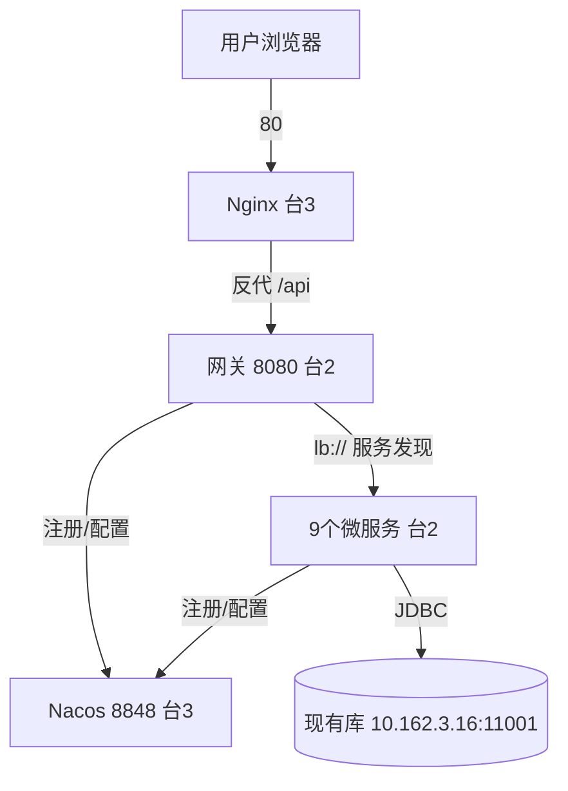

# 数据资产管理平台 · 部署操作文档

> 适用范围：3 台服务器测试验证环境（数据库 / 应用集群 / 中间件分机部署）
> 部署方式：Docker Compose ｜ 操作系统：麒麟 V10 Server（无桌面版）｜ 运行时：JDK 21

---

## 1. 部署拓扑

| 服务器 | 角色 | 配置建议 | 承载组件 | 对外开放端口 |
|---|---|---|---|---|
| 台1 | 数据库（已存在） | 直接连接，无需部署 | PostgreSQL 15 @ 10.162.3.16:11001 | 11001（仅内网） |
| 台2 | 应用集群 | 8C 16G / 100G SSD | 网关 + 9 个业务微服务 | 8080（仅内网） |
| 台3 | 中间件 | 4C 8G / 50G SSD | Nacos + 前端 Nginx | 80（对外）、8848/9848（仅内网） |



**部署顺序**：确认台1 现有数据库可达 → 台3（Nacos）→ 台2（微服务）→ 台3（前端 Nginx）→ 全链路验证。

---

## 2. 前置条件

1. 台2、台3 安装麒麟 V10 Server、Docker Engine 及 `docker compose` 插件（台1 数据库已存在，无需改动）。
2. 构建机（或任意一台）已完成编译，产出：
   - 后端：`codebase/backend/<模块>/target/<模块>-1.0.0-exec.jar`（10 个，需 JDK 21 编译）
   - 前端：`codebase/frontend/dist/`
3. 台2、台3 与现有数据库内网互通，端口放行规则见上表（台2 的 8080、数据库 11001 仅对内网开放，勿对公网）。
4. 台2、台3 各自准备好 `deploy/` 目录及其依赖（`codebase/backend`、`codebase/frontend/dist`、compose 文件、`nginx.frontend.template`）。

---

## 3. 数据库（台1，已存在，无需部署）

数据库服务器为现有环境，**无需任何部署操作**，应用集群通过环境变量直连：

| 项 | 值 |
|---|---|
| 地址 | `10.162.3.16:11001` |
| 库名 | `damplatform` |
| 用户 | `dam` |
| 密码 | 由 `.env` 的 `DB_PASSWORD` 提供 |

> 数据源**不走 Nacos 配置中心**，统一走环境变量 `SPRING_DATASOURCE_URL`（优先级高于 Nacos）。
> 如需自建一套全新 PG，可参考 [docker-compose.db.yml](./docker-compose.db.yml)（可选）。

---

## 4. 应用集群服务器（台2）【重点】

**编排文件**：[docker-compose.app.yml](./docker-compose.app.yml)

### 4.1 准备

```bash
# 上传后端源码目录（含各模块 target/*-exec.jar）到台2
# 目录结构需与编排文件中的 build context 一致：
#   /opt/dam/codebase/backend/<模块>/target/<模块>-1.0.0-exec.jar
#   /opt/dam/deploy/docker-compose.app.yml
```

### 4.2 配置环境变量

在 `deploy/` 下创建 `.env`（或直接 export），关键变量：

```bash
DB_HOST=10.162.3.16         # 现有数据库 IP（默认值，通常无需改）
DB_PORT=11001               # 现有数据库端口（默认值）
DB_PASSWORD=你的数据库密码
NACOS_HOST=192.168.1.13     # 台3 Nacos 内网 IP
# 智能体 LLM 密钥（调用外部大模型）
DAM_AGENT_CHAT_BASE_URL=https://llm-tp8.cuhkszmc.cn/v1/chat/completions
DAM_AGENT_CHAT_API_KEY=sk-xxx
DAM_AGENT_CODE_BASE_URL=https://coder.cuhkszmc.cn/v1/chat/completions
DAM_AGENT_CODE_API_KEY=sk-xxx
```

### 4.3 启动

```bash
cd deploy
docker compose -f docker-compose.app.yml up -d --build
```

启动顺序由编排自动控制：先起 9 个业务服务，最后起网关。

### 4.4 验证

```bash
# 1. 容器状态（应全部 Up）
docker compose -f docker-compose.app.yml ps

# 2. 检查服务是否注册到 Nacos（登录台3 Nacos 控制台「服务列表」）
#    http://<台3_IP>:8848/nacos  默认账号 nacos/nacos
#    应看到：dam-auth、dam-catalog、dam-lineage、dam-standard、
#           dam-quality、dam-security、dam-lifecycle、dam-operations、dam-agent、dam-gateway

# 3. 抽查启动日志（无 datasource / nacos 连接报错）
docker logs --tail 50 dam-catalog

# 4. 网关直连测试（在台2本机）
curl http://127.0.0.1:8080/api/catalog/category-types
```

> 常见问题：
> - 若服务未出现在 Nacos，检查台3 防火墙是否放行 8848/9848，以及 `NACOS_HOST` 是否配错。
> - 若报数据库连接失败，检查数据库 11001 端口是否放行，以及 `DB_HOST/DB_PORT/DB_PASSWORD`。

---

## 5. 中间件服务器（台3）【重点】

**编排文件**：[docker-compose.middleware.yml](./docker-compose.middleware.yml)
**Nginx 模板**：[nginx.frontend.template](./nginx.frontend.template)

### 5.1 部署 Nacos + 前端

```bash
cd deploy
# 指定后端网关地址（台2 内网 IP:8080）
export BACKEND_GATEWAY=192.168.1.12:8080

docker compose -f docker-compose.middleware.yml up -d
```

### 5.2 初始化 Nacos 配置中心

登录 `http://<台3_IP>:8848/nacos`（默认账号 `nacos/nacos`，已关闭鉴权），在「配置管理 → 配置列表」新建以下配置（group 保持 `DEFAULT_GROUP`）：

| dataId | 内容 | 说明 |
|---|---|---|
| `dam-catalog.yml` | `dam:\n  lineage-url: http://dam-lineage:8093\n  agent-url: http://dam-agent:8089` | 服务间调用地址，可动态切换 |
| `dam-agent.yml` | `dam:\n  agent:\n    chat-base-url: https://llm-tp8.cuhkszmc.cn/v1/chat/completions\n    chat-api-key: sk-xxx\n    chat-model: qwen3.8-27b-tp8\n    code-base-url: https://coder.cuhkszmc.cn/v1/chat/completions\n    code-api-key: sk-xxx\n    code-model: qwen3-coder-30b-a3b` | LLM 密钥（可选，暂用 .env 亦可） |

> 说明：各服务 `application.yml` 采用 `spring.config.import: optional:nacos:{服务名}.yml`，`optional` 前缀表示「Nacos 无该配置也能启动」。数据源在 Docker 部署下走环境变量（优先级高于 Nacos），不必放 Nacos。

### 5.3 验证

```bash
# 1. Nacos 就绪（返回 JSON）
curl http://127.0.0.1:8848/nacos/v1/console/health/readiness

# 2. 前端可访问（浏览器打开 http://<台3_IP>/）

# 3. 前端反代后端正常（经 Nginx 调后端接口）
curl http://<台3_IP>/api/catalog/category-types
```

---

## 6. 全链路验证清单

逐项通过即视为测试验证环境搭建成型：

| # | 验证项 | 方法 | 通过标准 |
|---|---|---|---|
| 1 | Nacos 注册 | 控制台「服务列表」 | 10 个服务全部在线 |
| 2 | 配置中心生效 | 改 `dam-catalog.yml` 观察 | 配置下发成功 |
| 3 | 网关服务发现 | 经网关请求各 `/api/*` | 返回 200，非 503 |
| 4 | 数据库连通 | 各服务启动日志 | 无 datasource 报错 |
| 5 | 前后端联调 | 浏览器访问 + 调接口 | 页面正常、`/api` 反代正常 |
| 6 | 核心业务链路 | 登录 → 采集 → 血缘/AI | 全链路跑通 |
| 7 | 数据持久化 | 重启 Nacos/微服务容器、重连现有库 | 数据不丢、服务可恢复 |

---

## 7. 迁移到生产（可回滚）

1. 生产机装好 Docker + 麒麟 V10，拷贝**同一套** `deploy/` 目录与 jar（镜像/构建零改动）。
2. 复制 `.env` 改成生产值（`DB_HOST`、`DB_PASSWORD`、`NACOS_HOST`、LLM 密钥）。
3. Nacos 配置：控制台「导出」测试环境 dataId →「导入」到生产 `prod` namespace。
4. 数据库：沿用现有库，或按需 `pg_dump` 导出迁移（现有库直接连接，无需搬运卷）。
5. 按「确认现有库可达 → 台3 → 台2」顺序启动，跑第 6 节清单。
6. 回滚：测试环境保留作为应急入口，生产异常时切回测试环境。

---

## 附：文件清单

| 文件 | 用途 |
|---|---|
| `docker-compose.db.yml` | 可选：自建 PG 时使用（现有库无需部署） |
| `docker-compose.app.yml` | 台2 应用集群编排 |
| `docker-compose.middleware.yml` | 台3 中间件（Nacos + Nginx）编排 |
| `nginx.frontend.template` | 前端 Nginx 反代模板 |
| `Dockerfile` | 后端通用镜像（eclipse-temurin:21-jre） |
| `build.sh` | 一键构建后端 jar + 前端 dist |
